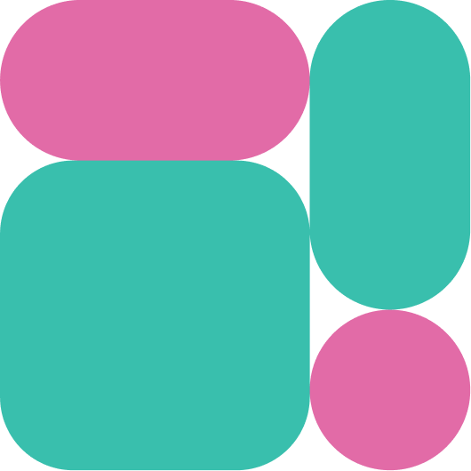

<div align="center">
  <picture>
    
  </picture>
  <h1>Malga Tokenization SDK</h1>
</div>


Simple way to tokenize cards with Malga

## Getting Started

First of all, you'll need to install our SDK into your project:

```bash
yarn add @malga/tokenization
# or
npm install @malga/tokenization
# or
pnpm add @malga/tokenization
```

1. Add the identification keys for each field involving card data in your form

```html
<form onSubmit="{handleGetTokenId}">
  <section>
    <div className="form-group">
      <label htmlFor="card-number">Card Number</label>
      <div id="card-number" className="form-control"></div>
    </div>
    <div className="form-group">
      <label htmlFor="card-holder-name">Card Holder Name</label>
      <div id="card-holder-name" className="form-control"></div>
    </div>
    <div className="form-group">
      <label htmlFor="card-cvv">Card CVV</label>
      <div id="card-cvv" className="form-control"></div>
    </div>
    <div className="form-group">
      <label htmlFor="card-expiration-date">Card Expiration Date</label>
      <div id="card-expiration-date" className="form-control"></div>
    </div>
  </section>
  <button type="submit">Submit</button>
</form>
```

2. Now all you need to do is configure our SDK with your keys and call the tokenize method in your function handling the form submit

```ts
import { MalgaTokenization } from '@malga/tokenization'

const malgaTokenization = new MalgaTokenization({
  apiKey: '<YOUR_API_KEY>',
  clientId: '<YOUR_CLIENT_ID>',
  options: {
    config: {
      fields: {
        cardNumber: {
          container: 'card-number',
          placeholder: '9999 9999 9999 9999',
        },
        cardHolderName: {
          container: 'card-holder-name',
          placeholder: 'Its a test',
        },
        cardExpirationDate: {
          container: 'card-expiration-date',
          placeholder: 'MM/YY',
        },
        cardCvv: {
          container: 'card-cvv',
          placeholder: '999',
        },
      },
      styles: {
        // With this object, it's possible to change the styles of input components
        input: {
          color: '#000',
          'font-size': '16px',
        },
      },
      preventAutofill: false,
    },
    sandbox: true,
  },
})

// You can use others events like:
malgaTokenization.on('cardTypeChanged', (event) => {
  console.log('cardTypeChanged', event)
})

malgaTokenization.on('validity', (event) => {
  console.log('validation', event)
})

malgaTokenization.on('blur', (event) => {
  console.log('blur', event)
})

malgaTokenization.on('focus', (event) => {
  console.log('blur', event)
})

malgaTokenization.on('loading', ({ isLoading }) => {
  submitButton.disabled = isLoading
})

async function handleSubmit(event) {
  event.preventDefault()

  const { tokenId } = await malgaTokenization.tokenize()
  console.log({ tokenId })

  // Now you just need to send the tokenId along with
  // the rest of the transaction data to your API
}
```

3. Submit the form and see the magic happen 💳

For more details on the implementation, you can access our documentation by [clicking here](https://docs.malga.io/docs/sdks/tokenization/intro).

### Loading and timeout

`loading` is `true` when a `tokenize()` starts and `false` when it finishes. If the card number iframe does not answer within 30 seconds, `tokenize()` resolves with `{ tokenId: '', error: { type: 'timeout', code: 0, message } }` and `loading` goes back to `false`.

### Missing card data

Before sending anything, `tokenize()` checks that every field configured in `config.fields` has a value. If any is empty, it resolves right away, without a request and without `loading`, with `{ tokenId: '', error: { type: 'invalid_request_error', code: 0, message, details } }`, where `details` lists the missing fields (`['cardCvv', 'cardExpirationDate']`). Fields you didn't configure are not required.

### Containers and more than one card

- A `container` can be any element `id` (`card-number`, `numero`, `card.number`...). The collected data is keyed by the field (`cardNumber`, `cardCvv`...), never by the container name.
- To render two or more cards on the same page, create one `MalgaTokenization` per card, each one with its own containers. A container `id` must never repeat on the page.
- Each instance keeps its collected card in `sessionStorage` under `malga-card-<cardNumber container>` (it was `malga-card` before). Only relevant if you read that key directly.
- Two live instances can't share a container, and one instance can't use the same container for two fields. The constructor throws before rendering anything, naming the container: `ContainerInUseError` or `DuplicatedContainerError`. Call `destroy()` on the old instance first.

### Destroying an instance

`destroy()` undoes everything the constructor set up: it removes the iframes from the containers (and the classes the SDK added to them), stops waiting for containers that aren't in the DOM yet, removes the message listener and the `on()` handlers, clears the collected card from `sessionStorage` and frees the containers for a new instance. After it, `tokenize()` throws. Calling it more than once is safe.

Call it whenever the checkout unmounts. Without it, mounting the screen again throws `ContainerInUseError`, because the old instance still holds the containers.

> **Upgrading to 5.0.0:** in 4.x, creating a new instance on the same containers without cleanup silently stacked a second set of iframes and kept the old listener alive. Now the constructor throws `ContainerInUseError`. If your screen can mount more than once (React `useEffect` without a cleanup, `StrictMode`, navigating back to the route), call `destroy()` when it unmounts, as below.

```js
// React
useEffect(() => {
  const malgaTokenization = new MalgaTokenization({ apiKey, clientId, options })

  return () => malgaTokenization.destroy()
}, [])
```

## Examples

If you have any doubts about the integration, you can [click here](https://github.com/plughacker/malga-tokenization/tree/main/examples) to see some examples

## Contributing

Feel free to contribute to this project by submitting pull requests, creating documentation, or bringing ideas to make the project even better!
